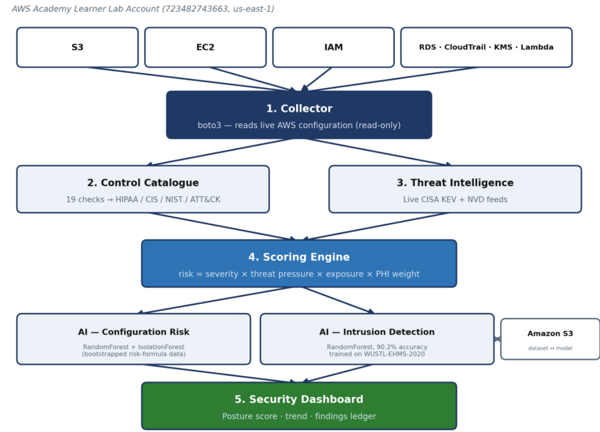
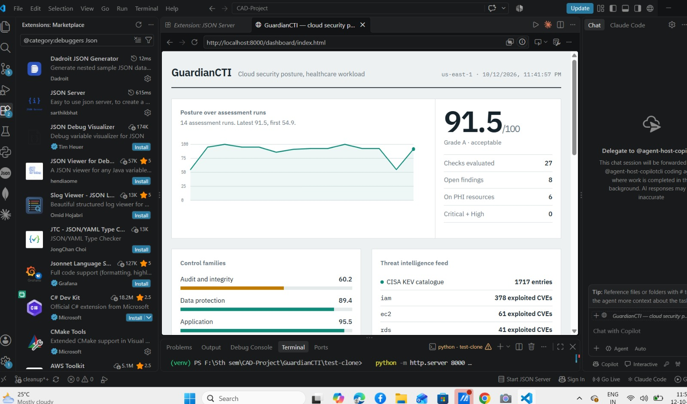
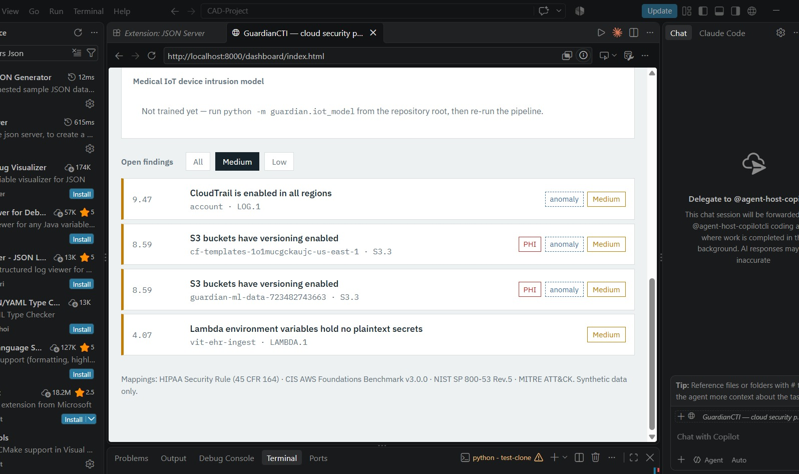
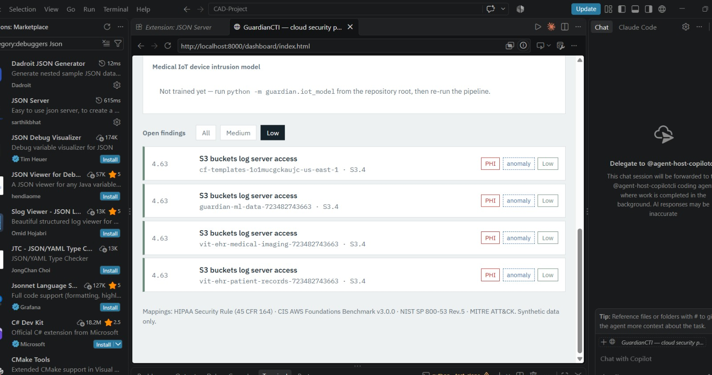
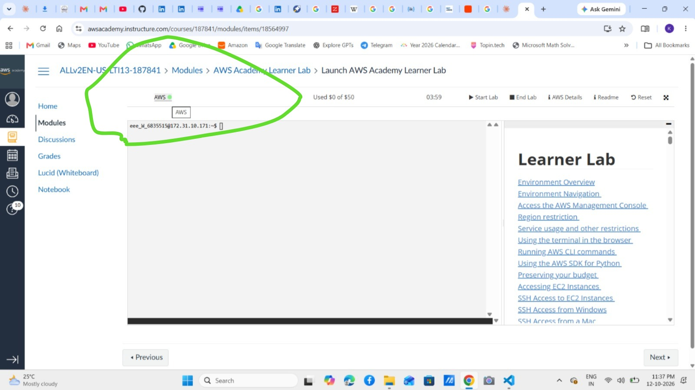
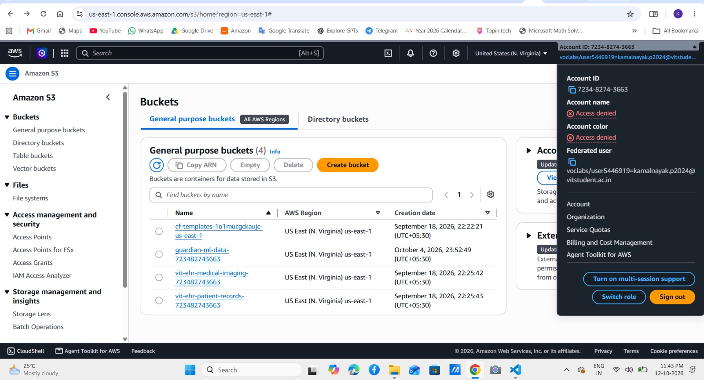
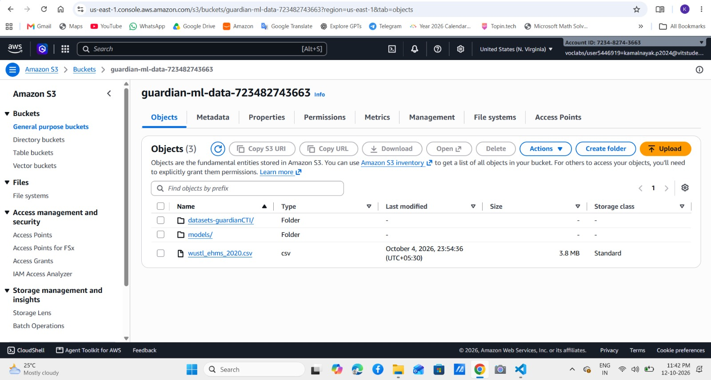
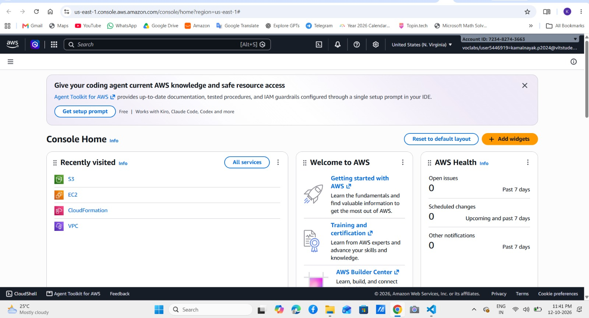

<div align="center">


<br/>

**Continuous threat intelligence · compliance-mapped findings · ML-ranked remediation**

<br/>


<sub>BCSE355L Cloud Architecture Design · VIT Vellore · Guide: Dr. Priya V</sub>

</div>

<br/>

---

## 01 — Problem and Solution

Healthcare organisations keep Electronic Health Records, imaging and telemedicine data in the cloud. A public bucket, an open port or an unencrypted database is one of the most common causes of a real-world breach, and periodic static audits can't keep pace with how fast configurations and attacker priorities change.

**GuardianCTI** reads the configuration of a live AWS account, checks it against **27 healthcare-relevant controls**, enriches each failure with live threat intelligence, ranks the results with machine learning, and reports a posture score with the exact fix for every finding. It never reads or stores patient data.

> **The question it answers:** given a dozen open misconfigurations and one afternoon, which should a hospital administrator fix first?
> A static CIS scanner answers with fixed weights. GuardianCTI adds **what is being exploited right now**, **whether the resource holds PHI**, and **whether the finding is unusual for this account**.

---

## 02 — Architecture



Each stage is an independently runnable Python module; `guardian/pipeline.py` runs them all in one command.

---

## 03 — Features

| | Feature | What it does |
|---|---|---|
| ◆ | **Live threat intelligence** | CISA KEV (1,717 entries at last fetch) and NVD become a per-service threat-pressure multiplier, so ranking shifts as attacker focus shifts |
| ◆ | **27 compliance-mapped checks** | Every finding carries HIPAA §164.312, CIS AWS Foundations v3.0.0, NIST SP 800-53 Rev. 5 and MITRE ATT&CK references |
| ◆ | **PHI-aware scoring** | Severity is multiplied by whether the affected resource is tagged as holding patient health information |
| ◆ | **AI-blended ranking** | RandomForest priority + IsolationForest anomaly score re-rank the formula output |
| ◆ | **Medical IoT intrusion model** | RandomForest trained on real healthcare traffic; dataset, model and metrics live in S3 |
| ◆ | **Recommendation engine** | Every finding ships with a specific remediation, ordered by rank |
| ◆ | **Single-file dashboard** | Posture score, run-over-run trend, per-family scores, threat-intel panel, expandable ledger. No build step |

<details>
<summary><b>◆ The two models, side by side</b></summary>

<br/>

| | Configuration-risk model | Medical IoT intrusion model |
|---|---|---|
| **Module** | `guardian/ai_model.py` | `guardian/iot_model.py` |
| **Algorithms** | RandomForest (priority) + IsolationForest (anomaly) | RandomForest |
| **Data** | Bootstrapped from the project's own risk formula, since no public labelled dataset of cloud misconfigurations exists | WUSTL-EHMS-2020: real captured traffic plus patient biometrics |
| **Input** | 16-dimension finding vector | 36 features (28 network flow + 8 biometric) |
| **Output** | Priority class, confidence, anomaly score | Normal / attack label, feature importance |

Two models matched to two different data realities, rather than forcing one dataset or model type to serve both problems.

</details>

---

## 04 — Results

<div align="center">









</div>

### Posture assessment on a live AWS account

<div align="center">


</div>

Latest run: **91.5 / 100** across 14 assessment runs (first run 54.9).

| Control family | Score | |
|---|---|---|
| Audit and integrity | 60.2 | ██████░░░░ |
| Data protection | 89.4 | █████████░ |
| Application | 95.5 | ██████████ |
| Network and host | 100 | ██████████ |

**Current top of the ranking**

| Score | Check | Resource | Severity |
|---|---|---|---|
| 9.47 | `LOG.1` CloudTrail enabled in all regions | account | ● Medium |
| 8.59 | `S3.3` S3 versioning enabled | cf-templates, guardian-ml-data | ● Medium |
| 4.07 | `LAMBDA.1` no plaintext secrets in env vars | vit-ehr-ingest | ● Medium |
| 4.63 | `S3.4` S3 server access logging | four buckets | ● Low |

<details>
<summary><b>◆ Remediation waves on the target stack (first evaluation, 19-check catalogue)</b></summary>

<br/>

| Run | Action | Score | Open | Crit + High |
|---|---|---|---|---|
| 1 | Baseline, no remediation | 85.9 (B) | 9 / 23 | 1 |
| 2 | Closed exposed security group (SSH, MySQL, all-protocol) | 91.1 (A) | 7 / 23 | 0 |
| 3 | Enabled S3 versioning on patient-records bucket | 92.5 (A) | 6 / 23 | 0 |

</details>

### Medical IoT intrusion detection · WUSTL-EHMS-2020

<div align="center">


</div>

16,318 records (14,272 normal / 2,046 attack) · 75/25 stratified split · 300 trees, max depth 14, balanced class weights. Metrics are written to `ids_metrics.json`.

| Test set (n = 4,080) | Predicted normal | Predicted attack |
|---|---|---|
| **Actual normal** | 3,280 | 288 |
| **Actual attack** | 113 | 399 |

The strongest signals are packet-timing jitter and load irregularities (`DIntPkt`, `DstJitter`, `SrcLoad`), the timing fingerprint of a man-in-the-middle interception. The dataset authors (Hady et al., 2020) reported 91.56% with k-NN; this untuned RandomForest is comparable while adding feature-importance explainability inside an S3-integrated pipeline.

> Six identifier columns (`Flgs`, `SrcAddr`, `DstAddr`, `SrcMac`, `DstMac`, `Label`) are excluded from training to prevent label leakage, since the dataset authors built the label from the source MAC address.

---

## 05 — Languages and Tools

<div align="center">


</div>

---

## 06 — AWS Console Infrastructure Setup





---

## 07 — Quick Start

```bash
git clone https://github.com/pkn367/GuardianCTI.git && cd GuardianCTI
python -m venv .venv && source .venv/bin/activate     # Windows: .venv\Scripts\activate
pip install -r requirements.txt

python -m guardian.ai_model                            # train configuration-risk models
python -m guardian.pipeline --offline                  # full run on synthetic account state
python -m http.server 8000                             # serve the dashboard
```

Then open **http://localhost:8000/dashboard/index.html**.

<details>
<summary><b>◆ Run against a real AWS account</b></summary>

<br/>

Drop `--offline` after exporting Learner Lab credentials (Canvas → **AWS Details**, copy all three values):

```bash
export AWS_ACCESS_KEY_ID=... AWS_SECRET_ACCESS_KEY=... AWS_SESSION_TOKEN=...
python -m guardian.pipeline --region us-east-1 -v
```

Deploy the deliberately misconfigured healthcare workload with `infra/target_stack.yaml` (CloudFormation).

</details>

<details>
<summary><b>◆ Train the Medical IoT model</b></summary>

<br/>

The dashboard panel shows "not trained yet" until this has been run once. With the WUSTL-EHMS-2020 CSV in `guardian-ml-data-<account-id>` and credentials exported:

```bash
python -m guardian.iot_model     # streams CSV from S3, trains, uploads model + metrics to models/
python -m guardian.pipeline      # re-run so the dashboard picks up the result
```

</details>

---

## 08 — Project Structure

```
GuardianCTI/
├── guardian/
│   ├── checks.py        27 controls mapped to HIPAA / CIS / NIST / ATT&CK
│   ├── collector.py     boto3 collectors: S3, EC2, IAM, RDS, CloudTrail, KMS, Lambda
│   ├── cti.py           CISA KEV + NVD feeds, cached, offline fallback
│   ├── scoring.py       likelihood x impact risk model, per-family posture score
│   ├── ai_model.py      RandomForest priority + IsolationForest anomaly
│   ├── iot_model.py     RandomForest intrusion detector, S3-integrated
│   └── pipeline.py      orchestrator → out/findings.json, dashboard/data.js
├── dashboard/index.html single-file dashboard, no build step
├── infra/target_stack.yaml   CloudFormation target workload
├── lambda_handler.py    scheduled Lambda entry point, S3 snapshots, SNS alerts
├── Architecture/        diagrams
└── Results/             screenshots, metrics, sample output
```

<details>
<summary><b>◆ Target environment (deliberately misconfigured)</b></summary>

<br/>

| Resource | Purpose |
|---|---|
| `vit-ehr-patient-records-…` (S3) | Tagged PHI; deliberately under-configured |
| `vit-ehr-medical-imaging-…` (S3) | Hardened control bucket: encrypted, versioned, public access blocked |
| `vit-ehr-app-sg` (security group) | Initially open on SSH, MySQL and all protocols to 0.0.0.0/0 |
| `vit-ehr-ingest` (Lambda) | Holds a plaintext database password in its environment |

Supporting buckets: `guardian-ml-data-…` (dataset and `models/`) and a CloudFormation templates bucket.

</details>

---

## 09 — Project Status

<div align="center">

</div>

| Section | Implementation | Status |
|---|---|---|
| 8.1 Resource monitoring | `lambda_handler.py` + EventBridge | ● Written and tested, not yet deployed |
| 8.2 Configuration collection | `guardian/collector.py` | ✓ Complete, verified on real AWS |
| 8.3 Threat intelligence | `guardian/cti.py` | ✓ Complete |
| 8.4 Feature engineering | `ai_model.featurise`, IoT preprocessing | ✓ Complete |
| 8.5 AI risk analysis | `ai_model.py`, `iot_model.py` | ✓ Two models operational |
| 8.6 Posture assessment | `guardian/scoring.py` | ✓ Complete, before/after verified |
| 8.7 Recommendation engine | `remediation` per control | ✓ Complete |
| 8.8 Dashboard | `dashboard/index.html` | ✓ Working, IoT panel wired in |

**Next up:** deploy the scheduled Lambda on EventBridge · enable CloudTrail to close the top open finding · retrain the configuration model on real findings · optional SageMaker training.

<details>
<summary><b>◆ Deviations from the proposal, and why</b></summary>

<br/>

| Proposed | Built | Reason |
|---|---|---|
| MongoDB | JSON snapshots in S3 | No persistent server in the Learner Lab; finding volume is dozens per run |
| TensorFlow | scikit-learn | Small feature space (up to 36 dims); classical models are more explainable at this scale |
| Grafana / Power BI | Single-file dashboard | No server can run through a 4-hour lab session; deploys as a static S3 site |
| VirusTotal / OpenCTI | CISA KEV + NVD | Authoritative, keyless, maps to service classes rather than file hashes |
| Security Hub / GuardDuty | Custom detection engine | Not on the Learner Lab's allowed service list |
| React + FastAPI | Deferred | Listed as future work |

</details>

<details>
<summary><b>◆ Known limitations</b></summary>

<br/>

- **IAM policy inspection:** the Learner Lab denies reading certain pre-existing VocLab policy versions. The collector logs this per policy and continues; it is a lab permission boundary, not a tool defect.
- **Scheduling:** assessments are currently triggered manually until the EventBridge rule is deployed.
- **Training data:** the configuration-risk model is bootstrapped from the project's own formula, not real incident history.
- **Open findings** on the target account are intentionally left as the next remediation waves.

</details>

---

## 10 — Cost and Data Safety

> The target stack is empty S3 buckets, one security group and one uninvoked Lambda: effectively zero against the $50 lab budget. Don't add EC2, RDS or NAT Gateways unless demonstrating a specific check, and delete them the same session. Check the **Used $X of $50** counter in Canvas after every session.

> ◆ **Synthetic data only.** Never place real or identifiable patient data in this stack.

---

## 11 — Team

<div align="center">

<table style="border: none; border-collapse: collapse;">
  <tr>
    <td align="center">
      <a href="https://github.com/arun1e">
        
      </a>
      <br>
      <a href="https://github.com/arun1e"><b>@arun1e</b></a>
      <br>
      <sub>24BIT0551</sub>
    </td>
    <td align="center">
      <a href="https://github.com/SaharshKrishna06">
        
      </a>
      <br>
      <a href="https://github.com/SaharshKrishna06"><b>@SaharshKrishna06</b></a>
      <br>
      <sub>24BIT0521</sub>
    </td>
    <td align="center">
      <a href="https://github.com/pkn367">
        
      </a>
      <br>
      <a href="https://github.com/pkn367"><b>@pkn367</b></a>
      <br>
      <sub>24BIT0367</sub>
    </td>
  </tr>
</table>

**Guide:** Dr. Priya V, Associate Professor Senior, SCORE, VIT Vellore

</div>

---

## 12 — References

1. A. A. Hady, A. Ghubaish, T. Salman, D. Unal and R. Jain, "Intrusion Detection System for Healthcare Systems Using Medical and Network Data: A Comparison Study," *IEEE Access*, vol. 8, pp. 106576–106584, 2020.
2. [CISA Known Exploited Vulnerabilities Catalog](https://www.cisa.gov/known-exploited-vulnerabilities-catalog)
3. [NIST National Vulnerability Database](https://nvd.nist.gov/)
4. [MITRE ATT&CK](https://attack.mitre.org/)
5. CIS AWS Foundations Benchmark v3.0.0 · NIST SP 800-53 Rev. 5 · HIPAA Security Rule, 45 CFR Part 164 Subpart C

<br/>

<div align="center">


</div>